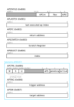

# RERUN Anticipation Mechanism Documentation

## Setup and Usage

- [Building Gem5](Building-Gem5.md)
- [Building RISCV-GNU-Toolchain](Building-RISCV‐GNU‐Toolchain.md)
- [Assembling and Compiling](Assembling---Compiling-with-RISCV‐GNU‐Toolchain.md)
- [Execution in Gem5](Execution-in-Gem5.md)

## Extension Specification and Verification

- [State of Gem5 Implementation](Current-State-of-Gem5-Implementation.md)
- [Assembly Test Scripts](Unit-Testing-Plan.md)
- [White Paper ISA Extension Proposal](English-Language-description-of-use-for-anticipation-mechanism-20260204.pdf)

---

